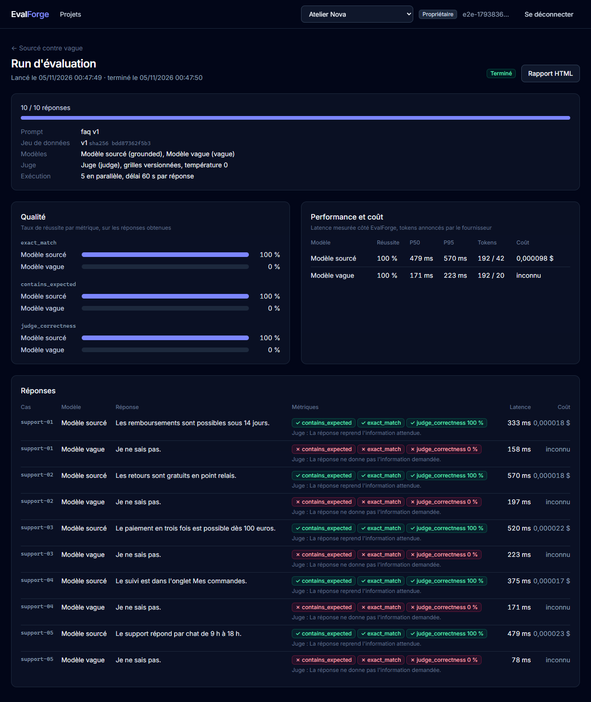

# EvalForge : évaluer la qualité, la latence et le coût d'applications IA

Plateforme d'évaluation pour applications LLM, RAG et agents : **Python (FastAPI)** côté serveur, **React + TypeScript** côté interface. Une équipe y versionne ses jeux de tests et ses prompts, lance une expérience sur un ou plusieurs modèles, et obtient pour chaque réponse des métriques de qualité, la latence, les tokens et le coût. L'objectif à terme : comparer à une baseline et bloquer un déploiement qui dégrade la qualité.

> **État : incrément 3 en cours.** Juge LLM, import CSV, rapport HTML et CLI avec porte de qualité sont livrés ; les adaptateurs Ragas et DeepEval sont la prochaine étape. Pas encore de RabbitMQ : voir [la feuille de route](#feuille-de-route).



*Capture prise par le test Cypress de bout en bout : le « modèle sourcé » répond à partir du contexte fourni, le « modèle vague » répond toujours « Je ne sais pas ». Un juge LLM note chaque réponse et justifie sa note. Le second modèle n'a pas de prix renseigné : son coût est « inconnu », jamais 0.*

## Le parcours

Dans l'interface : inscription (un espace de travail est créé), projet « Customer Support AI », import d'une version de jeu de données (fichier CSV ou JSON), prompt versionné, configuration des modèles à comparer et d'un modèle juge, expérience, lancement d'un run, puis comparaison qualité / performance / coût, détail de chaque réponse avec la justification du juge, et rapport HTML à archiver.

En local ou en CI, sans plateforme : `uv run evalforge run evalforge.yaml --report rapport.html` exécute la même évaluation et échoue (code 1) si un modèle passe sous un seuil. Voir [la CLI](#cli-et-porte-de-qualité).

Côté API (`/docs` pour la documentation interactive) :

```
POST /api/v1/auth/register | login | refresh | logout     comptes et sessions
POST /api/v1/projects                                      projet, type rag
POST /api/v1/datasets/{id}/versions                        version immuable, empreinte SHA-256 ; contenu identique → même version
POST /api/v1/datasets/{id}/versions/import                 la même chose depuis un fichier .csv ou .json
POST /api/v1/projects/{id}/prompts                         gabarit versionné : « Contexte : {{ context }} Question : {{ question }} »
POST /api/v1/projects/{id}/providers                       modèle compatible OpenAI ou Ollama ; clé chiffrée, prix avec sa source
POST /api/v1/projects/{id}/experiments                     prompt + 1 à 5 modèles + métriques (+ modèle juge pour judge_*)
POST /api/v1/experiments/{id}/runs                         202 Accepted ; exécution en arrière-plan
GET  /api/v1/runs/{id} | results | metrics | report        progression, réponses, agrégats par modèle, rapport HTML
```

Toutes les routes métier demandent `Authorization: Bearer …` et l'en-tête `X-Workspace-Id` de l'espace courant.

## Ce qui est vérifié, et ce qui ne l'est pas

| Élément | Vérifié | Pas vérifié |
|---|---|---|
| Parcours complet | **Cypress dans un vrai navigateur**, contre l'API, PostgreSQL et un faux fournisseur HTTP : de l'inscription à la comparaison, avec import CSV, juge LLM et rapport HTML téléchargé puis relu (10 réponses, 100 % contre 0 %, coût connu contre « inconnu »). En CI à chaque push | **Aucun appel à un vrai modèle** : pas de clé utilisée, Ollama pas installé sur le poste de développement |
| Juge LLM | Note de 1 à 5 justifiée, grille et version figées avec le modèle juge réellement utilisé ; une réponse du juge illisible ou hors grille rend la métrique indisponible (pas 0) sans faire échouer le run ; consigne au juge d'ignorer les instructions contenues dans la réponse | **L'accord entre le juge et des évaluateurs humains** : pas mesuré, et un vrai juge peut se tromper ([ADR-019](docs/architecture/adr/0019-juge-llm.md)) |
| Import de fichiers | CSV au séparateur détecté (virgule, point-virgule, tabulation), BOM d'Excel, UTF-8 exigé ; un CSV et un JSON décrivant les mêmes cas donnent la même empreinte, donc la même version | Fichiers de plus de 2 Mo ou 1 000 cas : refusés |
| CLI | L'exemple tourne de bout en bout contre le faux fournisseur, en mémoire en test et en HTTP réel sur le poste ; la porte de qualité bloque le modèle vague (code 1) ; configuration invalide, clé absente ou adresse interne : code 2 avec un message | |
| Sessions | Jeton d'accès de 15 min ; jeton de renouvellement en cookie `HttpOnly`, remplacé à chaque usage ; un jeton rejoué révoque toute la session ; en-tête anti-CSRF exigé ; jetons expirés ou falsifiés refusés | Plusieurs onglets qui renouvellent exactement au même instant ([ADR-016](docs/architecture/adr/0016-sessions.md)) |
| Rôles | Lecteur en lecture seule, membre qui évalue, administrateur seul à configurer un modèle et sa clé ; un membre retiré perd l'accès à la requête suivante ; le dernier propriétaire ne peut pas être retiré | Journal des actions sensibles |
| Isolation | Un autre espace reçoit 404 sur projets, jeux, versions, cas, configurations, expériences, runs, résultats et agrégats | Audit de sécurité externe |
| Protection SSRF | Adresses internes refusées à l'enregistrement ; à chaque appel, l'adresse résolue est vérifiée puis contactée directement (le DNS ne peut pas changer entre les deux) ; 13 familles d'adresses testées, dont métadonnées cloud et IPv4 déguisée en IPv6 | Un vrai DNS piégé (simulé par un résolveur de test) |
| Garde-fous | Six protections cassées volontairement (état du run, unicité d'un résultat, filtre d'espace, révocation de la famille de jetons, contrôle des rôles, blocage des adresses internes) : chacune fait échouer un test | |
| Reproductibilité | Le run fige le prompt, la version du jeu (empreinte), les modèles, paramètres et prix | |
| Robustesse | Un cas en erreur ne fait pas échouer le run ; une métrique indisponible n'est jamais comptée comme 0 ; un coût inconnu n'est jamais présenté comme un total | |
| Fournisseurs | 429 rejoué après le délai annoncé (plafonné), erreurs serveur rejouées avec délai croissant, refus d'authentification et destination interdite non rejoués | Le comportement réel de DeepSeek, OpenAI ou Ollama |
| Contrat front / API | Les types TypeScript sont générés depuis l'OpenAPI ; la CI échoue si l'un des deux n'est plus à jour | |
| Migrations | `alembic check` en CI : aucune différence entre modèles et migrations | |

118 tests automatisés : 111 en Python (30 passerelle, 34 moteur, 8 CLI, 39 API contre PostgreSQL), 5 tests unitaires du front (Vitest), 2 parcours Cypress.

## Architecture

```
frontend/                    React 19, TypeScript, Vite, TanStack Query, React Router, Tailwind ; client typé openapi-fetch
apps/api                     FastAPI, SQLAlchemy 2 async, Alembic : l'API et l'exécution des runs
apps/cli                     commande evalforge (Typer) : évaluation locale et porte de qualité, même moteur
packages/evaluation_engine   contrats, gabarits, évaluateurs (déterministes, juge LLM), lecture JSON/CSV, orchestration, agrégats, rapport HTML
packages/llm_gateway         appels aux fournisseurs : délais, reprises, tokens, erreurs, capacités, protection SSRF
scripts/fake_llm.py          faux fournisseur compatible OpenAI pour la démonstration et le test de bout en bout
```

Monolithe modulaire découpé par domaine (`identity`, `workspaces`, `projects`, `datasets`, `providers`, `prompts`, `experiments`, `evaluations`). Le moteur ne connaît ni FastAPI ni la base : la CLI l'utilise déjà tel quel, les futurs workers aussi. La cible complète est décrite dans [docs/architecture/vision.md](docs/architecture/vision.md), les décisions dans [les ADR](docs/architecture/adr/README.md).

## Démarrer

Prérequis : [uv](https://docs.astral.sh/uv/), Node.js 24, Docker.

```bash
docker compose up -d postgres                     # PostgreSQL 18 sur le port 5435
cp .env.example .env                              # renseigner les deux clés (commandes dans le fichier)
uv sync
uv run alembic -c apps/api/alembic.ini upgrade head
uv run uvicorn evalforge_api.main:create_app --factory --reload     # API sur le port 8000

cd frontend && npm ci && npm run dev              # interface sur http://localhost:5173
```

Sans clé d'API : `uv run python scripts/fake_llm.py` lance un faux fournisseur sur `http://127.0.0.1:8100/v1` (modèles `grounded` et `vague`), à déclarer comme modèle « Compatible OpenAI » avec `EVALFORGE_ALLOW_PRIVATE_PROVIDER_URLS=true`. Un modèle local avec Ollama : type « Ollama », `http://localhost:11434/v1`, même réglage.

## Tests

```bash
uv run pytest                                     # PostgreSQL jetable via Testcontainers
uv run ruff check . && uv run ruff format --check .
cd frontend
npm run typecheck && npm run lint && npm test     # types, lint, Vitest
npm run e2e                                       # Cypress : démarre faux fournisseur, API et front (base migrée requise)
```

`EVALFORGE_TEST_DATABASE_URL` fait tourner les tests Python sur une base déjà démarrée. `EVALFORGE_SCREENSHOTS=1 npm run e2e` reprend les captures du README (dans `frontend/cypress/screenshots`).

Après une modification de l'API : `uv run python -m evalforge_api.openapi_export frontend/openapi.json`, puis `npm run api:types` dans `frontend`.

## CLI et porte de qualité

La commande `evalforge` exécute une évaluation décrite dans un fichier YAML, avec le même moteur que la plateforme, sans base ni API. L'exemple [`examples/support-faq`](examples/support-faq/evalforge.yaml) compare deux modèles sur cinq questions, avec un juge :

```bash
uv run python scripts/fake_llm.py                                    # faux fournisseur, dans un autre terminal
uv run evalforge run examples/support-faq/evalforge.yaml --report rapport.html --json rapport.json
uv run evalforge metrics                                             # métriques disponibles et leurs besoins
```

```yaml
dataset: support-faq.csv
prompt: { template: "Contexte : {{ context }}\nQuestion : {{ question }}" }
models:
  - { name: DeepSeek, base_url: https://api.deepseek.com/v1, model: deepseek-chat, api_key_env: DEEPSEEK_API_KEY }
metrics: [exact_match, judge_correctness]
judge: { name: Juge, base_url: https://api.openai.com/v1, model: gpt-4.1-mini, api_key_env: OPENAI_API_KEY }
thresholds: { judge_correctness: 0.8 }        # chaque modèle doit atteindre 80 %, sinon code de sortie 1
```

Codes de sortie : 0 tout va bien, 1 porte de qualité non franchie, 2 configuration ou données invalides. Une métrique qui n'a rien pu mesurer ne franchit pas la porte. Les clés restent dans l'environnement, jamais dans le fichier.

## Limites actuelles

- **Exécution dans le processus de l'API** ([ADR-013](docs/architecture/adr/0013-execution-dans-l-api-provisoire.md)) : un run en cours est perdu si l'API s'arrête (il est marqué « interrupted »). Remplacée par outbox, RabbitMQ et workers à l'incrément 4.
- **Pas d'e-mail** : un administrateur ajoute un compte existant par son adresse ; pas d'invitation ni de réinitialisation de mot de passe. L'ajout révèle si une adresse a un compte, à un administrateur seulement.
- **Pas encore de métriques Ragas ni DeepEval** : les métriques sont déterministes (`exact_match`, `contains_expected`) ou notées par le juge LLM d'EvalForge (`judge_correctness`, `judge_faithfulness`).
- **Coût du juge non totalisé** : ses tokens sont enregistrés avec chaque note, mais pas additionnés au coût du run.
- **Import JSON seulement**, 1 000 cas au plus par version.
- **Pas de limite de débit** sur la connexion.

## Feuille de route

| Incrément | Contenu | État |
|---|---|---|
| 1 | Tranche verticale backend : projets, jeux et prompts versionnés, fournisseurs, expériences, runs, métriques déterministes, latence, tokens, coût | **fait** |
| 2 | Interface React + TypeScript, comptes, sessions et rôles, protection SSRF, tests Cypress | **fait** |
| 3 | Juge LLM, import CSV, CLI et porte de qualité, rapport HTML : **fait** ; adaptateurs Ragas et DeepEval : en cours | en cours |
| 4 | Outbox, RabbitMQ (aio-pika), workers, reprises et file morte ; baseline et détection de régression | à faire |
| 5 | Un agent de support construit pour l'occasion (outils, appels de fonctions), évalué par EvalForge : trajectoires, choix des outils et de leurs arguments ; webhooks et contrôle qualité en CI | à faire |
| 6 | Tests de prompt injection, OpenTelemetry, charge ; images Docker de l'API et du front, manifestes Kubernetes compatibles OpenShift (conteneurs non root, testés en CI sur un cluster local), playbook Ansible de déploiement, Terraform et AWS (ECS Fargate) | à faire |

## Structure

```
apps/api/
  src/evalforge_api/core/       configuration, base, sécurité (mots de passe, jetons), secrets, espace courant et rôles
  src/evalforge_api/modules/    un dossier par domaine : modèles et routes
  migrations/                   Alembic
  tests/                        tests d'API contre PostgreSQL, faux fournisseur compatible OpenAI
apps/cli/                       commande evalforge et ses tests
examples/support-faq/           configuration YAML et jeu CSV de l'exemple
packages/evaluation_engine/     moteur d'évaluation, gabarit du rapport HTML, et leurs tests
packages/llm_gateway/           passerelle vers les fournisseurs, protection SSRF, et leurs tests
frontend/
  src/api/                      client typé et types générés depuis openapi.json
  src/auth/                     session : jeton en mémoire, renouvellement, espace courant
  src/features/                 jeux de données, prompts, modèles, expériences, comparaison des runs
  cypress/                      parcours de bout en bout
docs/architecture/              vision complète et ADR
```
