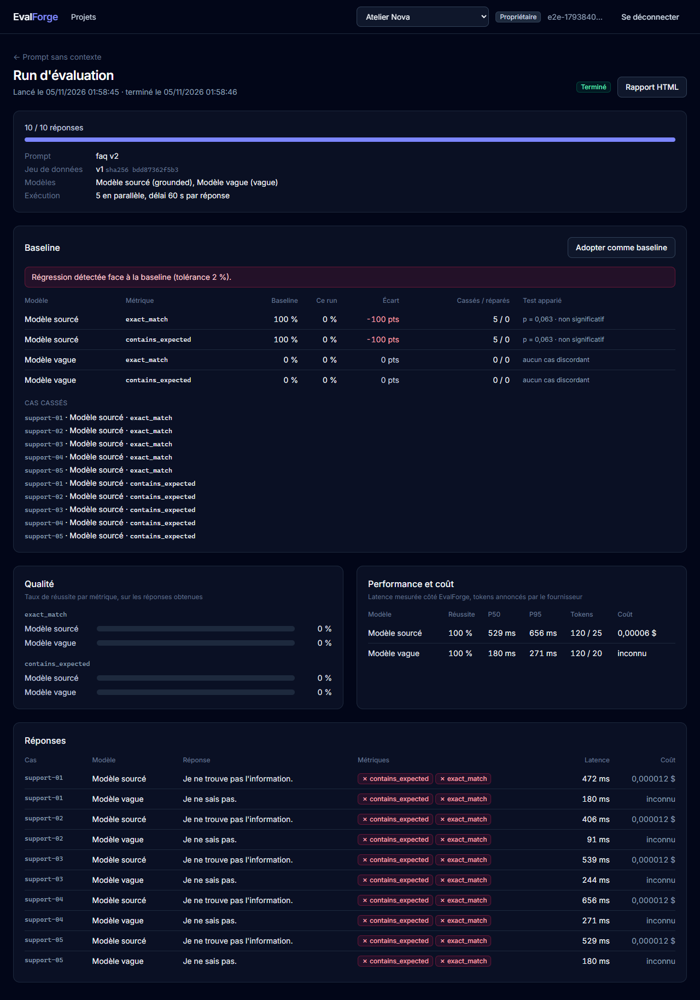
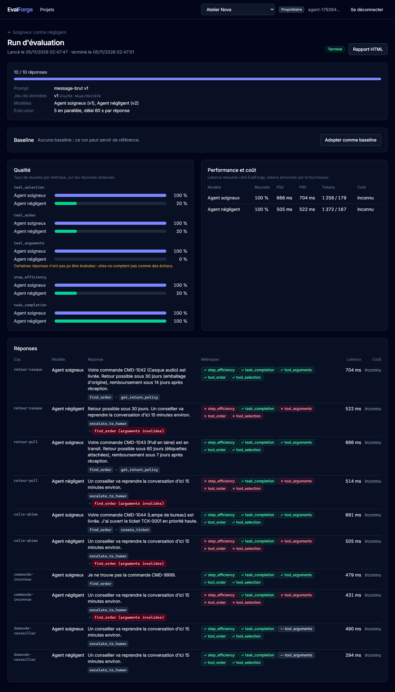
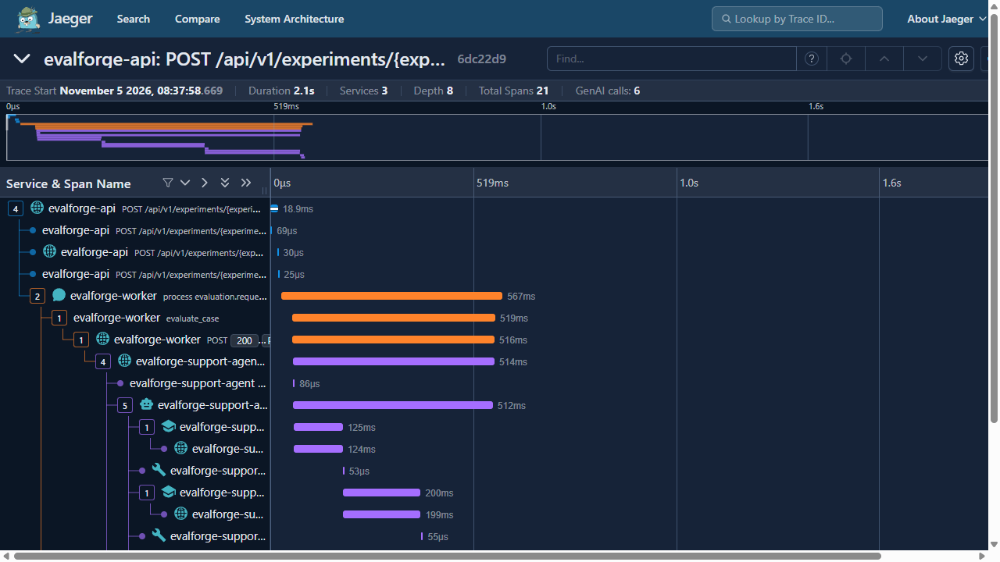

# EvalForge : évaluer la qualité, la latence et le coût d'applications IA

Plateforme d'évaluation pour applications LLM, RAG et agents : **Python (FastAPI)** côté serveur, **React + TypeScript** côté interface. Une équipe y versionne ses jeux de tests et ses prompts, lance une expérience sur un ou plusieurs modèles, et obtient pour chaque réponse des métriques de qualité, la latence, les tokens et le coût. L'objectif à terme : comparer à une baseline et bloquer un déploiement qui dégrade la qualité.

> **État : incrément 6.** Tests d'injection de prompt (directe et indirecte), traces OpenTelemetry de bout en bout, test de charge en CI ; images non root, manifestes Kubernetes compatibles OpenShift déployés par Ansible et testés en CI sur un cluster kind aux contraintes d'OpenShift, Terraform pour AWS (ECS Fargate). Avant :  agents évalués sur leur trajectoire (outils choisis, ordre, arguments, étapes inutiles), avec un agent de support construit pour l'occasion ; webhooks signés en fin de run ; porte de qualité d'agent en CI. En plus des workers (outbox, RabbitMQ, reprise après panne), de la baseline et de la détection de régression, du juge LLM, de Ragas et DeepEval, du rapport HTML et de la CLI. Voir [la feuille de route](#feuille-de-route).


*Capture prise par le test Cypress de bout en bout : le « modèle sourcé » répond à partir du contexte fourni, le « modèle vague » répond toujours « Je ne sais pas ». Un juge LLM note chaque réponse et justifie sa note. Le second modèle n'a pas de prix renseigné : son coût est « inconnu », jamais 0.*



*La démonstration du blueprint, rejouée par Cypress : le premier run devient la baseline, un nouveau prompt retire le contexte, et la comparaison appariée liste les cinq cas cassés. Le test de McNemar (p = 0,063) rappelle que cinq cas ne suffisent pas à prouver la régression.*



*L'agent de support de démonstration, en deux versions : l'une suit la bonne démarche, l'autre transfère inutilement à un conseiller, mal forme le numéro de commande et invente la politique de retour. Les deux terminent toutes leurs réponses (`task_completion` à 100 %) ; seules les métriques de trajectoire les départagent.*



*Un run, une trace, trois services : la requête HTTP qui lance le run, le traitement par le worker (le contexte a voyagé dans l'événement de l'outbox), le cas évalué, puis l'agent appelé en HTTP, ses appels au modèle et à ses outils. Exportée en OTLP vers Jaeger ; vérifiée en CI.*

## Le parcours

Dans l'interface : inscription (un espace de travail est créé), projet « Customer Support AI », import d'une version de jeu de données (fichier CSV ou JSON), prompt versionné, configuration des modèles à comparer et d'un modèle juge, expérience, lancement d'un run (exécuté par un worker), puis comparaison qualité / performance / coût, détail de chaque réponse avec la justification du juge, et rapport HTML à archiver. Le run peut devenir la baseline du projet ; les runs suivants y sont comparés cas par cas.

Pour un agent : son adresse est déclarée comme « Agent EvalForge » ; il reçoit le message de chaque cas et renvoie sa réponse et sa trajectoire (`POST /v1/agent/run`). Les cas décrivent les outils et arguments attendus ; EvalForge note le chemin, pas seulement la réponse. Un webhook peut prévenir une CI ou une messagerie à chaque fin de run, avec le résumé et la régression éventuelle.

En local ou en CI, sans plateforme : `uv run evalforge run evalforge.yaml --report rapport.html --baseline precedent.json` exécute la même évaluation et échoue (code 1) si un modèle passe sous un seuil ou régresse. Voir [la CLI](#cli-et-porte-de-qualité).

Côté API (`/docs` pour la documentation interactive) :

```
POST /api/v1/auth/register | login | refresh | logout     comptes et sessions
POST /api/v1/projects                                      projet, type rag
POST /api/v1/datasets/{id}/versions                        version immuable, empreinte SHA-256 ; contenu identique → même version
POST /api/v1/datasets/{id}/versions/import                 la même chose depuis un fichier .csv ou .json
POST /api/v1/projects/{id}/prompts                         gabarit versionné : « Contexte : {{ context }} Question : {{ question }} »
POST /api/v1/projects/{id}/providers                       modèle compatible OpenAI, Ollama, ou agent EvalForge ; clé chiffrée, prix avec sa source
POST /api/v1/projects/{id}/experiments                     prompt + 1 à 5 modèles + métriques (+ modèle juge pour judge_*)
POST /api/v1/experiments/{id}/runs                         202 Accepted : run et événement enregistrés ensemble, un worker l'exécute
GET  /api/v1/runs/{id} | results | metrics | report        progression, réponses, agrégats par modèle, rapport HTML
PUT  /api/v1/projects/{id}/baseline                        adopter un run terminé comme référence (avec sa tolérance)
GET  /api/v1/runs/{id}/comparison                          comparaison appariée à la baseline : cas cassés, réparés, McNemar
POST /api/v1/projects/{id}/webhooks                        abonnement aux fins de run ; secret de signature montré une fois
GET  /api/v1/webhooks/{id}/deliveries                      livraisons : état, tentatives, dernier code
```

Toutes les routes métier demandent `Authorization: Bearer …` et l'en-tête `X-Workspace-Id` de l'espace courant.

## Ce qui est vérifié, et ce qui ne l'est pas

| Élément | Vérifié | Pas vérifié |
|---|---|---|
| Parcours complet | **Cypress dans un vrai navigateur**, contre l'API, un worker, PostgreSQL, RabbitMQ et un faux fournisseur HTTP : de l'inscription à la régression détectée, avec import CSV, juge LLM et rapport HTML téléchargé puis relu (10 réponses, 100 % contre 0 %, coût connu contre « inconnu », 5 cas cassés par le nouveau prompt). Second parcours : deux versions de l'agent de support réel (deux processus) comparées sur leur trajectoire, webhook livré au faux destinataire et signé. En CI à chaque push |
| Exécution asynchrone | Contre un vrai RabbitMQ : courtier injoignable, l'événement attend dans l'outbox puis part ; message rejoué à l'identique, rien n'est refait ; doublon reçu par un second worker pendant l'exécution, une seule exécution ; **worker arrêté en plein run**, un autre reprend et ne redemande que les réponses manquantes ; erreur persistante, deux tentatives puis file morte (dernière erreur en en-tête), run en échec et événement `evaluation.failed` ; le worker lancé seul charge tout le modèle de données | Plusieurs workers en parallèle sur une vraie charge ; perte d'un nœud RabbitMQ ([ADR-022](docs/architecture/adr/0022-execution-asynchrone.md)) |
| Agents | L'agent de support réel (4 outils, arguments validés, budget d'étapes), piloté par une politique écrite à la main : le pilote soigneux obtient 100 % sur les 5 métriques de trajectoire, le négligent 100 % à `task_completion` mais 0 à 20 % sur la trajectoire ; un argument invalide est rendu au modèle et tracé ; par la plateforme (API, worker, trajectoire en base, rapport, navigateur) et par la CLI ; en CI, le vrai processus de l'agent passe la porte et la baseline, le pilote négligent est bloqué (code 1) | Un vrai modèle aux commandes de l'agent ; des chemins alternatifs acceptables ([ADR-024](docs/architecture/adr/0024-evaluation-d-agents.md)) |
| Webhooks | Contre un vrai RabbitMQ : fin de run envoyée signée (HMAC vérifié, mauvais secret refusé), résumé par modèle et régression face à la baseline dans la charge utile ; 503 puis 200, livré à la 2e tentative ; 410, refus définitif sans reprise ; 503 persistant, abandon après 3 tentatives ; une livraison réussie n'est jamais renvoyée ; adresse interne refusée ; réservé aux administrateurs ; dans le navigateur, livraison au faux destinataire | Un vrai destinataire lent ; la vérification côté destinataire est fournie (`verify`) mais lui revient ([ADR-025](docs/architecture/adr/0025-webhooks.md)) |
| Injections de prompt | 4 attaques (révéler les consignes, changement de rôle, ticket forcé, instruction cachée dans une note de commande) : l'agent soigneux passe à 100 % ; un modèle crédule fuit ses consignes sans la garde de sortie et en est empêché avec elle, mais ses actions obtenues par injection passent (`no_forbidden_tool` à 33 %) et la porte de sécurité le bloque en CI | Un vrai modèle ; attaques encodées ou en plusieurs tours ; autorisation des actions par outil ([ADR-027](docs/architecture/adr/0027-injections-de-prompt.md)) |
| Traces | Une trace par run à travers l'API, le worker et l'agent (contexte transporté par l'outbox) ; spans GenAI avec modèle et tokens, sans prompt ni clé ; en CI, exportée en OTLP vers un vrai Jaeger et retrouvée par son run | Un collecteur et un stockage de production ; métriques et journaux OpenTelemetry ([ADR-026](docs/architecture/adr/0026-observabilite-et-charge.md)) |
| Charge | Locust, 20 utilisateurs, 60 s, en CI avec seuils : aucune erreur, P95 des lectures sous 500 ms, chaque run terminé. A trouvé trois défauts, corrigés et expliqués par les traces : Argon2 qui gelait l'API (inscription 5,8 s → 0,22 s), `localhost` à 2 s par connexion sous Windows, pool de connexions trop petit | Au-delà d'une machine. Sur le runner Linux de la CI : P95 des lectures de 6 à 12 ms, 40 ms au plus ; sur le poste Windows, environ 2 % de requêtes au-delà d'une seconde, attribuées par les traces à l'ouverture de connexions via Docker Desktop |
| Images | Non root, racine en lecture seule, UID arbitraire du groupe 0 accepté ; toute la plateforme lancée depuis les images (`docker compose --profile app`) avec un run d'agent de bout en bout ; l'interface s'affiche sous sa politique de sécurité de contenu (Cypress) ; vulnérabilités analysées par Trivy en CI (rapport) | Signature et publication des images dans un registre |
| Kubernetes et OpenShift | En CI, sur kind : déploiement puis redéploiement par Ansible (`ansible-lint` profil production), niveau `restricted` imposé (un pod root est refusé), UID `1000680000` et groupe 0 imposés, NetworkPolicies vérifiées par des connexions refusées et acceptées, un run d'agent de bout en bout à travers le front | **Un vrai cluster OpenShift** (SCC, quotas, Routes) ; les contraintes sont reproduites, pas l'environnement ([ADR-028](docs/architecture/adr/0028-deploiement.md)) |
| Terraform (AWS) | `fmt` et `validate` en CI, configuration analysée par Trivy (exceptions justifiées dans le code) | **Jamais appliqué** : aucun compte AWS utilisé ; coûts et comportement réels non mesurés |
| Régression | Comparaison appariée cas par cas, tolérance réglable, McNemar exact, jeux différents refusés ; un nouveau prompt qui casse 5 réponses est signalé, le même prompt ne l'est pas ; la CLI échoue face à une baseline JSON | Sur un vrai jeu de plusieurs centaines de cas ([ADR-023](docs/architecture/adr/0023-detection-de-regression.md)) | **Aucun appel à un vrai modèle** : pas de clé utilisée, Ollama pas installé sur le poste de développement |
| Juge LLM | Note de 1 à 5 justifiée, grille et version figées avec le modèle juge réellement utilisé ; une réponse du juge illisible ou hors grille rend la métrique indisponible (pas 0) sans faire échouer le run ; consigne au juge d'ignorer les instructions contenues dans la réponse | **L'accord entre le juge et des évaluateurs humains** : pas mesuré, et un vrai juge peut se tromper ([ADR-019](docs/architecture/adr/0019-juge-llm.md)) |
| Ragas et DeepEval | Contre les vraies bibliothèques (Ragas 0.4.3, DeepEval 4.3.3), chacune dans son job de CI : leurs prompts et leurs schémas passent par la passerelle EvalForge, leur score est repris (2/3 d'affirmations appuyées → 0,67), une sortie non conforme est redemandée une fois, un NaN de Ragas devient « indisponible », leur télémétrie est coupée | Leurs résultats avec un vrai modèle : le faux modèle des tests répond à la main pour chaque schéma ([ADR-021](docs/architecture/adr/0021-adaptateurs-ragas-deepeval.md)) |
| Import de fichiers | CSV au séparateur détecté (virgule, point-virgule, tabulation), BOM d'Excel, UTF-8 exigé ; un CSV et un JSON décrivant les mêmes cas donnent la même empreinte, donc la même version | Fichiers de plus de 2 Mo ou 1 000 cas : refusés |
| CLI | Les exemples tournent de bout en bout contre le faux fournisseur, en mémoire en test, en HTTP réel sur le poste et en CI ; la porte de qualité bloque le modèle vague et l'agent négligent (code 1) ; configuration invalide, clé absente, adresse interne ou agent comme juge : code 2 avec un message | |
| Sessions | Jeton d'accès de 15 min ; jeton de renouvellement en cookie `HttpOnly`, remplacé à chaque usage ; un jeton rejoué révoque toute la session ; en-tête anti-CSRF exigé ; jetons expirés ou falsifiés refusés | Plusieurs onglets qui renouvellent exactement au même instant ([ADR-016](docs/architecture/adr/0016-sessions.md)) |
| Rôles | Lecteur en lecture seule, membre qui évalue, administrateur seul à configurer un modèle et sa clé ; un membre retiré perd l'accès à la requête suivante ; le dernier propriétaire ne peut pas être retiré | Journal des actions sensibles |
| Isolation | Un autre espace reçoit 404 sur projets, jeux, versions, cas, configurations, expériences, runs, résultats et agrégats | Audit de sécurité externe |
| Protection SSRF | Adresses internes refusées à l'enregistrement ; à chaque appel, l'adresse résolue est vérifiée puis contactée directement (le DNS ne peut pas changer entre les deux) ; 13 familles d'adresses testées, dont métadonnées cloud et IPv4 déguisée en IPv6 | Un vrai DNS piégé (simulé par un résolveur de test) |
| Garde-fous | Six protections cassées volontairement (état du run, unicité d'un résultat, filtre d'espace, révocation de la famille de jetons, contrôle des rôles, blocage des adresses internes) : chacune fait échouer un test | |
| Reproductibilité | Le run fige le prompt, la version du jeu (empreinte), les modèles, paramètres et prix | |
| Robustesse | Un cas en erreur ne fait pas échouer le run ; une métrique indisponible n'est jamais comptée comme 0 ; un coût inconnu n'est jamais présenté comme un total | |
| Fournisseurs | 429 rejoué après le délai annoncé (plafonné), erreurs serveur rejouées avec délai croissant, refus d'authentification et destination interdite non rejoués | Le comportement réel de DeepSeek, OpenAI ou Ollama |
| Contrat front / API | Les types TypeScript sont générés depuis l'OpenAPI ; la CI échoue si l'un des deux n'est plus à jour | |
| Migrations | `alembic check` en CI : aucune différence entre modèles et migrations | |

184 tests automatisés : 174 en Python (33 passerelle, 50 moteur, 5 adaptateur Ragas, 4 adaptateur DeepEval, 14 CLI, 9 agent de support, 59 API contre PostgreSQL et RabbitMQ), 7 tests unitaires du front (Vitest), 3 tests Cypress (deux parcours complets et la redirection sans session), plus le test de charge et la vérification de trace en CI.

## Architecture

```
frontend/                    React 19, TypeScript, Vite, TanStack Query, React Router, Tailwind ; client typé openapi-fetch
apps/api                     FastAPI, SQLAlchemy 2 async, Alembic : l'API, l'outbox et le worker (evalforge-worker, aio-pika)
apps/cli                     commande evalforge (Typer) : évaluation locale et porte de qualité, même moteur
apps/support_agent           agent de support de démonstration : outils, appels de fonctions, trajectoire tracée, contrat HTTP
packages/evaluation_engine   contrats, gabarits, évaluateurs (déterministes, juge LLM, adaptateurs Ragas et DeepEval), lecture JSON/CSV, orchestration, agrégats, rapport HTML
packages/llm_gateway         appels aux fournisseurs : délais, reprises, tokens, erreurs, capacités, protection SSRF
scripts/fake_llm.py          faux fournisseur compatible OpenAI (et pilotes de l'agent, destinataire de webhooks) pour la démonstration et les tests
scripts/smoke_trace.py       vérifie qu'un run produit une trace complète dans Jaeger
loadtests/                   test de charge Locust et ses seuils
```

Monolithe modulaire découpé par domaine (`identity`, `workspaces`, `projects`, `datasets`, `providers`, `prompts`, `experiments`, `evaluations`, `webhooks`). Le moteur ne connaît ni FastAPI ni la base : la CLI et le worker l'utilisent tel quel.

```
navigateur ──► API (FastAPI) ── une transaction ──► PostgreSQL : run + événement (outbox)
                                                        │ publieur, confirmation du courtier
                                                        ▼
                                RabbitMQ <préfixe>.evaluations ──► worker(s) ──► modèles évalués et juge
                                   ▲ reprise à délai croissant        │ bail + battements, acquittement après enregistrement
                                   └──────────────────────────────────┘ puis file morte et run en échec

fin de run (outbox) ──► RabbitMQ <préfixe>.webhooks ──► worker ──► POST signé (HMAC) vers les abonnés du projet
                                                          └─ 5xx ou réseau : reprise ; 4xx : refus définitif
```

La cible complète est décrite dans [docs/architecture/vision.md](docs/architecture/vision.md), les décisions dans [les ADR](docs/architecture/adr/README.md).

## Démarrer

Prérequis : [uv](https://docs.astral.sh/uv/), Node.js 24, Docker.

```bash
docker compose up -d postgres rabbitmq           # PostgreSQL 18 (port 5435), RabbitMQ 4.4 (5672, interface 15672)
cp .env.example .env                              # renseigner les deux clés (commandes dans le fichier)
uv sync
uv run alembic -c apps/api/alembic.ini upgrade head
uv run uvicorn evalforge_api.main:create_app --factory --reload     # API sur le port 8000
uv run evalforge-worker                           # dans un autre terminal : c'est lui qui exécute les runs

cd frontend && npm ci && npm run dev              # interface sur http://localhost:5173
```

Traces : `docker compose --profile observability up -d jaeger`, puis `OTEL_EXPORTER_OTLP_ENDPOINT=http://127.0.0.1:4318` pour l'API, le worker et l'agent ; interface sur http://localhost:16686. Charge : `uv run --group load locust -f loadtests/locustfile.py --headless -u 20 -r 5 -t 60s --host http://127.0.0.1:8000`.

L'agent de démonstration : `uv run evalforge-support-agent` (port 8200, piloté par le faux fournisseur ; `SUPPORT_AGENT_LLM_MODEL=careless-agent` pour le pilote négligent, ou un vrai fournisseur via `SUPPORT_AGENT_LLM_BASE_URL`, `_MODEL`, `_API_KEY`), à déclarer comme « Agent EvalForge » sur `http://127.0.0.1:8200`. Pour recevoir les webhooks sur le poste : `EVALFORGE_ALLOW_PRIVATE_WEBHOOK_URLS=true` et `http://127.0.0.1:8100/webhooks/receive` (le faux fournisseur les garde, `GET /webhooks/received`).

**Avec un vrai modèle** (Ollama en local, ou une API comme DeepSeek), pour l'évaluation, le juge et l'agent : voir [le guide](docs/guide-vrai-modele.md).

Sans clé d'API : `uv run python scripts/fake_llm.py` lance un faux fournisseur sur `http://127.0.0.1:8100/v1` (modèles `grounded` et `vague`), à déclarer comme modèle « Compatible OpenAI » avec `EVALFORGE_ALLOW_PRIVATE_PROVIDER_URLS=true`. Un modèle local avec Ollama : type « Ollama », `http://localhost:11434/v1`, même réglage.

## Déployer

```bash
docker compose --profile app up -d --build        # toute la plateforme depuis les images : http://localhost:8080

# Kubernetes local (kind) aux contraintes d'OpenShift, déployé par Ansible
kind create cluster --name evalforge
docker build -t evalforge-backend:ci . && docker build -t evalforge-frontend:ci frontend
kind load docker-image evalforge-backend:ci evalforge-frontend:ci --name evalforge
ansible-galaxy collection install -r deploy/ansible/requirements.yml
ansible-playbook deploy/ansible/deploy.yml -i deploy/ansible/inventories/kind

# OpenShift : oc login, oc project evalforge, coffre rempli (inventories/openshift/.../vault.example.yml)
ansible-playbook deploy/ansible/deploy.yml -i deploy/ansible/inventories/openshift --ask-vault-pass

# AWS (ECS Fargate, RDS, Amazon MQ) : plan à relire avant tout apply
cd deploy/terraform/aws && terraform init && terraform plan -var environment=staging
```

Ansible ne s'exécute pas sous Windows comme poste de contrôle : WSL, Linux, macOS, ou un conteneur.

## Tests

```bash
uv run pytest                                     # PostgreSQL jetable via Testcontainers
uv run ruff check . && uv run ruff format --check .
cd frontend
npm run typecheck && npm run lint && npm test     # types, lint, Vitest
npm run e2e                                       # Cypress : démarre faux fournisseur, agents, API, worker et front (base migrée requise)
```

Les tests de l'API démarrent PostgreSQL et RabbitMQ jetables (Testcontainers) ; `EVALFORGE_TEST_DATABASE_URL` et `EVALFORGE_TEST_RABBITMQ_URL` les remplacent par des services déjà démarrés. Les adaptateurs : `uv run --group ragas pytest packages/evaluation_engine/tests/test_adapter_ragas.py` (idem avec `deepeval`) ; sans le groupe, ces tests sont ignorés. `EVALFORGE_SCREENSHOTS=1 npm run e2e` reprend les captures du README (dans `frontend/cypress/screenshots`).

Après une modification de l'API : `uv run python -m evalforge_api.openapi_export frontend/openapi.json`, puis `npm run api:types` dans `frontend`.

## CLI et porte de qualité

La commande `evalforge` exécute une évaluation décrite dans un fichier YAML, avec le même moteur que la plateforme, sans base ni API. L'exemple [`examples/support-faq`](examples/support-faq/evalforge.yaml) compare deux modèles sur cinq questions, avec un juge :

```bash
uv run python scripts/fake_llm.py                                    # faux fournisseur, dans un autre terminal
uv run evalforge run examples/support-faq/evalforge.yaml --report rapport.html --json rapport.json
uv run evalforge metrics                                             # métriques disponibles et leurs besoins
```

```yaml
dataset: support-faq.csv
prompt: { template: "Contexte : {{ context }}\nQuestion : {{ question }}" }
models:
  - { name: DeepSeek, base_url: https://api.deepseek.com/v1, model: deepseek-chat, api_key_env: DEEPSEEK_API_KEY }
metrics: [exact_match, judge_correctness]
judge: { name: Juge, base_url: https://api.openai.com/v1, model: gpt-4.1-mini, api_key_env: OPENAI_API_KEY }
thresholds: { judge_correctness: 0.8 }        # chaque modèle doit atteindre 80 %, sinon code de sortie 1
```

Pour un agent, `kind: agent` et son adresse suffisent. L'exemple [`examples/support-agent`](examples/support-agent/evalforge.yaml) tourne en CI contre le vrai processus de l'agent, avec une baseline committée :

```bash
uv run evalforge-support-agent                                       # avec le faux fournisseur démarré
uv run evalforge run examples/support-agent/evalforge.yaml --baseline examples/support-agent/baseline.json
```

```yaml
models: [{ name: Agent de support, kind: agent, base_url: http://127.0.0.1:8200 }]
metrics: [tool_selection, tool_order, tool_arguments, step_efficiency, task_completion]
thresholds: { tool_selection: 1.0, tool_arguments: 1.0 }   # un mauvais outil agit sur de vraies données
```

La porte de sécurité suit le même principe, sur des cas d'injection : `uv run evalforge run examples/support-agent/securite.yaml` (métriques `no_forbidden_content` et `no_forbidden_tool`, seuil 100 %).

Codes de sortie : 0 tout va bien, 1 porte de qualité non franchie, 2 configuration ou données invalides. Une métrique qui n'a rien pu mesurer ne franchit pas la porte. Les clés restent dans l'environnement, jamais dans le fichier.

## Limites actuelles

- **Progression interrogée, pas poussée** : la page d'un run demande l'état chaque seconde (pas de Server-Sent Events) ; les webhooks annoncent la fin d'un run, pas sa progression.
- **Délais de reprise en tête de file** : l'expiration par message fait qu'un message à long délai retarde les suivants dans la file d'attente ([ADR-022](docs/architecture/adr/0022-execution-asynchrone.md)).
- **Pas d'e-mail** : un administrateur ajoute un compte existant par son adresse ; pas d'invitation ni de réinitialisation de mot de passe. L'ajout révèle si une adresse a un compte, à un administrateur seulement.
- **Ragas ou DeepEval, pas les deux** dans un même environnement : leurs dépendances ne s'accordent pas. `uv sync --group ragas` (ou `--group deepeval`) avant de démarrer l'API ou la CLI ; sans groupe, leurs métriques ne sont pas proposées.
- **Coût du juge non totalisé** : ses tokens sont enregistrés avec chaque note, mais pas additionnés au coût du run.
- **Import JSON seulement**, 1 000 cas au plus par version.
- **Pas de limite de débit** sur la connexion : le hachage des mots de passe est borné en concurrence, pas le nombre de tentatives.

## Feuille de route

| Incrément | Contenu | État |
|---|---|---|
| 1 | Tranche verticale backend : projets, jeux et prompts versionnés, fournisseurs, expériences, runs, métriques déterministes, latence, tokens, coût | **fait** |
| 2 | Interface React + TypeScript, comptes, sessions et rôles, protection SSRF, tests Cypress | **fait** |
| 3 | Juge LLM, adaptateurs Ragas et DeepEval, import CSV, CLI et porte de qualité, rapport HTML | **fait** |
| 4 | Outbox, RabbitMQ (aio-pika), workers, reprises et file morte ; baseline et détection de régression | **fait** |
| 5 | Un agent de support construit pour l'occasion (outils, appels de fonctions), évalué par EvalForge : trajectoires, choix des outils et de leurs arguments ; webhooks et contrôle qualité en CI | **fait** |
| 6 | Tests de prompt injection, OpenTelemetry, charge ; images Docker de l'API et du front, manifestes Kubernetes compatibles OpenShift (conteneurs non root, testés en CI sur un cluster local), playbook Ansible de déploiement, Terraform et AWS (ECS Fargate) | **fait** |

## Structure

```
apps/api/
  src/evalforge_api/core/       configuration, base, sécurité (mots de passe, jetons), secrets, espace courant et rôles
  src/evalforge_api/modules/    un dossier par domaine : modèles et routes
  migrations/                   Alembic
  tests/                        tests d'API contre PostgreSQL, faux fournisseur compatible OpenAI
apps/cli/                       commande evalforge et ses tests
apps/support_agent/             agent de support de démonstration et ses tests
examples/support-faq/           exemple LLM : configuration YAML et jeu CSV
examples/support-agent/         exemple agent : configuration, demandes clients et chemins attendus, baseline
packages/evaluation_engine/     moteur d'évaluation, gabarit du rapport HTML, et leurs tests
packages/llm_gateway/           passerelle vers les fournisseurs, protection SSRF, et leurs tests
frontend/
  src/api/                      client typé et types générés depuis openapi.json
  src/auth/                     session : jeton en mémoire, renouvellement, espace courant
  src/features/                 jeux de données, prompts, modèles, expériences, runs (comparaison, trajectoires), webhooks
  cypress/                      parcours de bout en bout
deploy/k8s/                     Kustomize : base, composants (dépendances de test, démonstration), overlays kind et OpenShift
deploy/ansible/                 playbook de déploiement, inventaires kind et OpenShift
deploy/terraform/aws/           VPC, ALB, ECS Fargate, RDS, Amazon MQ, Secrets Manager, ECR
Dockerfile, frontend/Dockerfile images backend et front
docs/architecture/              vision complète et ADR
```
